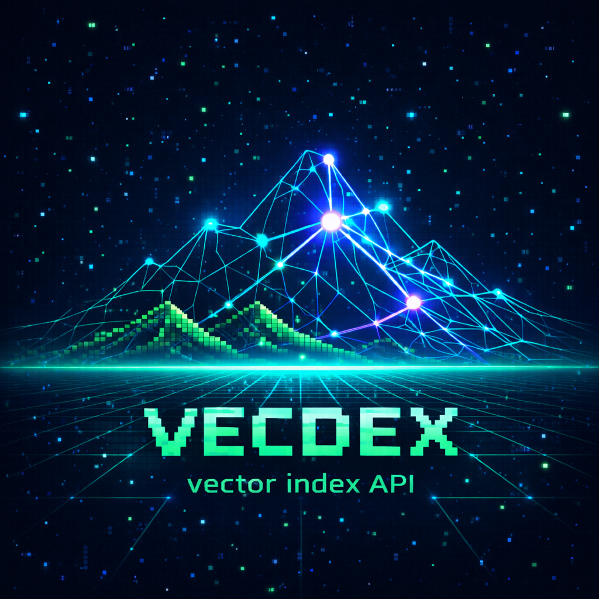

<p align="center">
  
</p>

<h3 align="center">Lightweight vector search engine on top of Valkey</h3>

<p align="center">
  <a href="https://goreportcard.com/report/github.com/kailas-cloud/vecdex"></a>
  <a href="https://app.codacy.com/gh/kailas-cloud/vecdex/dashboard"></a>
  <a href="https://app.codacy.com/gh/kailas-cloud/vecdex/dashboard"></a>
  <a href="https://github.com/kailas-cloud/vecdex/actions/workflows/tests.yml"></a>
  <a href="LICENSE"></a>
</p>

---

## Why vecdex?

Most vector databases are **heavy, cloud-locked, or expensive**. vecdex takes a different approach:

- **Zero new infrastructure** — runs on Valkey you already have
- **Automatic embeddings** — send text, get vectors (Nebius AI, OpenAI-compatible providers)
- **Three search modes** — hybrid (RRF), semantic (KNN), keyword (BM25) via one endpoint
- **Budget controls** — daily/monthly token limits with automatic tracking
- **300+ E2E tests** — battle-tested on the Valkey stack

## Examples

### Semantic code search

Define a struct, tag the fields, search with one line:

```go
package main

import (
    "context"
    "fmt"

    vecdex "github.com/kailas-cloud/vecdex/pkg/sdk"
)

type CodeChunk struct {
    ID       string `vecdex:"id"`
    Content  string `vecdex:"content,content"`
    Language string `vecdex:"language,tag"`
    Repo     string `vecdex:"repo,tag"`
}

func main() {
    ctx := context.Background()
    client, _ := vecdex.New(ctx,
        vecdex.WithValkey("localhost:6379", ""),
        vecdex.WithEmbedder(myEmbedder),       // any OpenAI-compatible provider
    )
    defer client.Close()

    idx, _ := vecdex.NewIndex[CodeChunk](client, "code-chunks")
    _ = idx.Ensure(ctx)

    // Index some code
    _ = idx.UpsertBatch(ctx, []CodeChunk{
        {ID: "1", Content: "CreateCollection validates the name and builds an FT index", Language: "go", Repo: "vecdex"},
        {ID: "2", Content: "SearchBuilder chains Query, Mode, Where, Limit into a query", Language: "go", Repo: "vecdex"},
        {ID: "3", Content: "BudgetTracker enforces daily and monthly token limits", Language: "go", Repo: "vecdex"},
    })

    // Semantic search — one line
    hits, _ := idx.Search().
        Query("how does collection creation work").
        Mode(vecdex.ModeSemantic).
        Where("language", "go").
        Limit(5).
        Do(ctx)

    for _, h := range hits {
        fmt.Printf("%.2f  %s\n", h.Score, h.Snippet)
    }
}
```


### Go client over HTTP

Use the same SDK types and methods through the server API:

```go
client, err := vecdex.NewHTTP("http://localhost:8080", apiKey)
if err != nil {
    return err
}
defer client.Close()

response, err := client.Search("articles").Query(ctx, "HNSW performance",
    &vecdex.SearchOptions{Limit: 5, MaxContentBytes: 2048})
```

Embedding and storage recovery run on the server. The HTTP client preserves JSON
metadata, source versions, per-item batch errors and SDK error sentinels.
`errors.As` can also inspect `HTTPError` for the HTTP status and request ID.
`WithHTTPClient` supplies a custom transport and timeout. Requests use the caller's
context. Redirects are returned to the caller. The SDK adds no retry loop;
the HTTP transport may retry replayable requests with an idempotency key.
Both HTTP and embedded clients work with `NewIndex[T]` and `NewTextIngestor`.
Typed index `Upsert` and `Delete` also accept `IfVersion` and `IdempotencyKey`.

### Low-level API

For full control without struct tags:

```go
client, _ := vecdex.New(ctx,
    vecdex.WithValkey("localhost:6379", ""),
    vecdex.WithEmbedder(myEmbedder),
)
defer client.Close()

// Create collection with filterable fields
client.Collections().Create(ctx, "articles",
    vecdex.WithField("author", vecdex.FieldTag),
    vecdex.WithField("year", vecdex.FieldNumeric),
)

// Upsert a document — embedding happens automatically
client.Documents("articles").Upsert(ctx, vecdex.Document{
    ID:       "article-1",
    Content:  "Vector search with HNSW indexes in Valkey",
    Metadata: map[string]any{"author": "alice", "year": 2025},
})

// Hybrid search (vector KNN + BM25 fused via RRF)
resp, _ := client.Search("articles").Query(ctx, "HNSW performance", &vecdex.SearchOptions{
    Mode:  vecdex.ModeHybrid,
    Limit: 10,
})

for _, r := range resp.Results {
    fmt.Printf("%.2f  %s\n", r.Score, r.Snippet)
}
```

## How it compares

| | vecdex | Pinecone | Qdrant | Weaviate | pgvector |
|---|---|---|---|---|---|
| Self-hosted | Yes | No | Yes | Yes | Yes |
| Managed cloud | No | Yes | Yes | Yes | Yes |
| Underlying storage | Valkey | Proprietary | Custom | Custom | PostgreSQL |
| Auto-embedding | Yes | No | No | Yes | No |
| Hybrid search (RRF) | Yes | Yes | Yes | Yes | No |
| Token budget tracking | Yes | No | No | No | No |
| Go SDK with generics | Yes | No | Yes | No | No |
| Setup complexity | Low | None | Medium | High | Low |
| License | Apache 2.0 | Proprietary | Apache 2.0 | BSD-3 | PostgreSQL |

## Search modes

| Mode | How it works | Embedding cost | Backend support |
|------|-------------|----------------|-----------------|
| `hybrid` (default) | Vector KNN + BM25 fused via Reciprocal Rank Fusion | 1 call | Valkey 9 + Valkey Search 1.2+ |
| `semantic` | Pure cosine-similarity KNN | 1 call | Valkey 9 |
| `keyword` | BM25 full-text search | 0 calls | Valkey Search 1.2+ |

## Backend support

| Backend | Status | Notes |
|---------|--------|-------|
| **Valkey 9 + Valkey Search 1.2+** | Supported | The only supported runtime target |
| AWS ElastiCache | Planned | |
| PostgreSQL + pgvector | Planned | |

Use official public Valkey/Search images. Search 1.2.1 has confirmed cluster
defects: small transactional writes can be omitted from search with multiple
writer threads, and consistent queries can abort a participant during topology
changes. The fixture tests the supported one-writer configuration as a workaround
for the first defect. Readiness requires one writer and
`search.max-worker-suspension-secs=0` on every participating Search 1.2.1 node,
including standalone deployments. Vecdex checks settings without changing server
configuration. See the [operations runbook](docs/operations.md) for node settings,
alert activation, capacity thresholds, expansion and the current scale-in restriction.
Online scaling is still under acceptance testing. See
[native reproducers and evidence](tests/cluster/KNOWN_FAILURES.md); Vecdex does
not require or ship a patched engine.

## Key features

| Feature | Description |
|---------|-------------|
| **Hybrid search** | Reciprocal Rank Fusion combining vector KNN and BM25 keyword search |
| **Semantic search** | Pure cosine-similarity KNN over HNSW vectors |
| **Keyword search** | BM25 full-text search — zero embedding tokens consumed |
| **Structured filters** | `must` / `should` / `must_not` with tag match and numeric range operators |
| **Auto-embedding** | Send text, get vectors via any OpenAI-compatible provider |
| **Typed Go SDK** | Schema-first generics with `TypedIndex[T]` and fluent search builder |
| **Batch operations** | Upsert/delete up to 100 items per call with per-item status |
| **Token budget** | Daily/monthly limits with warn or reject policies |
| **Cursor pagination** | Stable, opaque-cursor pagination for collections and documents |
| **Embedding cache** | SHA256-keyed cache in Valkey — identical content is never re-embedded |
| **Prometheus metrics** | Request latency, embedding tokens, budget, cache hit/miss |

## JSON document metadata

Documents accept a `metadata` JSON object, up to 64 KiB encoded. Nested objects,
arrays, booleans and null values are stored with the source document. Only
top-level fields declared in the collection schema are indexed as string tags or
numbers. Missing or null indexed values have no index entry. Other metadata is
returned by get, list and all three search modes, including hybrid ranking.

```json
{
  "content": "The agent learned that this service uses PostgreSQL.",
  "metadata": {
    "agent_id": "agent-1",
    "confidence": 0.95,
    "source": {"conversation": "chat-42", "message": 17},
    "labels": ["database", "infrastructure"]
  }
}
```

Send this body to `PUT /api/v2/collections/{collection}/documents/{id}`. Declare
`agent_id` as a tag and `confidence` as numeric to filter on them; `source` and
`labels` need no schema declaration. Document writes use only `metadata`; the
`tags` and `numerics` request fields were removed. Indexed numeric values use floating-point
index semantics; unindexed JSON numbers retain their precision. The Go SDK
returns metadata numbers as `json.Number`.

PATCH merges metadata using JSON Merge Patch semantics. Unmentioned members are
preserved, nested objects merge, arrays replace arrays and null members remove
keys. `{"metadata": null}` clears the complete object. Omitting metadata keeps it
unchanged. A metadata-only patch does not call the embedding provider. Use the
document's opaque version/ETag for conditional updates.

The embedded SDK exposes `Document.Metadata` as `map[string]any` and
`DocumentPatch.Metadata` as an optional pointer to that map. A pointer to a nil
map clears metadata; a nil pointer leaves it unchanged. Complete metadata is
stored once on the source, rather than copied into every search fragment.

## Architecture

```
┌─────────────────────────────────────────────────────┐
│              Go SDK  (pkg/sdk)                       │
│  TypedIndex[T] · SearchBuilder · Fluent API          │
├─────────────────────────────────────────────────────┤
│              HTTP API  (Chi)                          │
│  Auth · Metrics · Wide-event logging · Recovery       │
├─────────────────────────────────────────────────────┤
│                 Use Cases                             │
│  Collection · Document · Search · Batch · Embedding   │
├─────────────────────────────────────────────────────┤
│                Repositories                           │
│  Consumer interfaces (ISP) over Store facade          │
├─────────────────────────────────────────────────────┤
│              Valkey backend (rueidis, RESP2)         │
└─────────────────────────────────────────────────────┘
                         │
              Valkey 9 + valkey-search 1.2
```

Embedding pipeline (decorator chain):
```
OpenAIProvider → CachedProvider → InstrumentedProvider → StringVectorizer
       ↓               ↓                  ↓
  Nebius API     SHA256 cache       Prometheus +
                  in Valkey        BudgetTracker
```

## API reference

### Go SDK

```
go get github.com/kailas-cloud/vecdex
```

| Type | Description |
|------|-------------|
| `vecdex.Client` | Connection to Valkey, entry point for all operations |
| `vecdex.TypedIndex[T]` | Generic index with schema inferred from struct tags |
| `vecdex.SearchBuilder[T]` | Fluent search: `.Query()`, `.Mode()`, `.Where()`, `.Limit()`, `.Do()` |
| `vecdex.Hit[T]` | Search result with `.Item` and `.Score` |
| `vecdex.Document` | Untyped document for low-level API |
| `vecdex.Embedder` | Interface for text-to-vector providers |

Struct tag format: `vecdex:"name,modifier"` — modifiers: `id`, `content`, `tag`, `numeric`, `stored`.

Metadata fields are indexed only when declared in the collection schema. Names
such as `parent_doc_id` and `chunk_index` have no special meaning and do not
change source IDs or combine independent documents.

Both SDK transports return an opaque `Document.Version` from `Get` and `List`;
search results also carry the source version.
Use `IfVersion` with `Upsert`, `Patch`, or `Delete` to require that exact source
version. A stale condition returns `ErrRevisionConflict`, including after the
same ID has been deleted and recreated. `VersionConflictError.CurrentVersion`
contains the current token when the source still exists.

```go
current, err := client.Documents("articles").Get(ctx, "article-1")
if err != nil {
    return err
}
text := "Updated source text"
_, err = client.Documents("articles").Patch(ctx, current.ID,
    vecdex.DocumentPatch{Content: &text}, vecdex.IfVersion(current.Version))
```

`Upsert` and `Patch` return a compact `WriteResult` with `ID`, `Version` and
`Created`. HTTP PUT and PATCH return `{id, version, created}` plus a quoted
`ETag`; use `Get` to read the full committed source. GET document responses
include the same opaque `version` and ETag.
Send that ETag as `If-Match` on PUT, PATCH, or DELETE. Stale conditions return
409 `version_conflict`, with `current_version` and ETag when the document exists.
Batch upsert and delete accept `documents` arrays. Each item can include an
unquoted `if_version` token; omitted or null conditions are unconditional.
A conflict affects that item only and returns `version_conflict` plus
`current_version` when the source exists. A successful upsert returns its new
`version`. A batch is a sequence of independent source commits, with HTTP 200
and per-item statuses after the request body has been accepted.

```go
response, err := client.Documents("articles").BatchUpsert(ctx, []vecdex.BatchUpsertItem{
    {ID: current.ID, Content: "Updated source", Metadata: current.Metadata, IfVersion: current.Version},
    {ID: "new-source", Content: "A new source"},
})
```

The SDK uses `[]BatchUpsertItem` for `BatchUpsert` and `TextIngestor.Upsert`, and
`[]BatchDeleteItem` for `BatchDelete`. Both embedded and HTTP clients preserve
per-item conflict details and successful source versions.

Use `IdempotencyKey` when retrying a write after losing its response:

```go
written, err := client.Documents("articles").Upsert(ctx,
    vecdex.Document{ID: "article-1", Content: "A source document"},
    vecdex.IdempotencyKey("operation-123"))
```

The same key and input return the original successful outcome for 24 hours,
without embedding or committing again. Keep the original `IfVersion` on retries.
Keys belong to a source ID within one collection generation. Reusing a key with
another operation or payload returns `ErrIdempotencyConflict`; an active attempt
returns `ErrIdempotencyInProgress`. Failed attempts release their reservation.
An interrupted reservation expires after its bounded lease. After 24 hours,
the key can start a new write.

HTTP PUT, PATCH and DELETE accept `Idempotency-Key` (1–128 printable ASCII
characters, without spaces). Batch requests use each item's `idempotency_key`
or SDK `IdempotencyKey` field. A batch has independent source commits, so it
rejects the request-level header. Successful items replay independently;
failed items can be retried with the same input and key.

Sources can have an absolute `expires_at` deadline in UTC Unix milliseconds.
PUT and batch upsert accept a positive integer; omission or JSON null makes the
source persistent. PATCH preserves an omitted deadline and clears it with JSON
null. The Go SDK uses `Document.ExpiresAt` and `BatchUpsertItem.ExpiresAt`; for
`DocumentPatch.ExpiresAt`, nil preserves the deadline and a pointer to zero clears
it. A deadline change updates the source version without calling the embedder.

```go
deadline := time.Now().Add(24 * time.Hour).UnixMilli()
written, err := client.Documents("articles").Upsert(ctx, vecdex.Document{
    ID: "temporary", Content: "A temporary source", ExpiresAt: &deadline,
}, vecdex.IdempotencyKey("create-temporary"))
```

Keep the original absolute deadline when retrying an idempotent request. Reads,
search, similar-source lookup, and counts exclude expired sources immediately;
search filters expiry before its candidate limit. Background maintenance removes
their stored text, fragments and index entries and resumes after restart. A list
page can be empty while still carrying a cursor past expired IDs. Continue until
the cursor is absent. Recreating an expired ID starts a new incarnation, so its
former version cannot authorize a write or cleanup. A past deadline is accepted
and makes the committed source immediately invisible; its successful idempotency
receipt remains available for the normal 24 hours.

### REST API

Search returns ranked source IDs, opaque versions, JSON metadata and `snippet`.
Use `Get` for the full source text. `limit` defaults to 10 (maximum 100);
`max_content_bytes` bounds the combined UTF-8 snippet bytes, defaults to 16 KiB,
and has a maximum of 160 KiB. Small text budgets keep all ranked IDs.
Candidate expansion for fragments is internal; `top_k` is no longer accepted.

Full OpenAPI 3.0 specification: [`api/openapi.yaml`](api/openapi.yaml)

| Method | Path | Description |
|--------|------|-------------|
| `POST` | `/api/v2/collections` | Create collection |
| `GET` | `/api/v2/collections` | List collections (cursor pagination) |
| `GET` | `/api/v2/collections/{name}` | Get collection details |
| `DELETE` | `/api/v2/collections/{name}` | Delete collection |
| `PUT` | `/api/v2/collections/{name}/documents/{id}` | Upsert document (auto-embeds) |
| `GET` | `/api/v2/collections/{name}/documents/{id}` | Get document |
| `PATCH` | `/api/v2/collections/{name}/documents/{id}` | Update text or metadata; text changes re-embed |
| `DELETE` | `/api/v2/collections/{name}/documents/{id}` | Delete document |
| `GET` | `/api/v2/collections/{name}/documents` | List documents (cursor pagination) |
| `POST` | `/api/v2/collections/{name}/search` | Search documents |
| `POST` | `/api/v2/collections/{name}/documents/batch-upsert` | Batch upsert (up to 100) |
| `POST` | `/api/v2/collections/{name}/documents/batch-delete` | Batch delete (up to 100) |
| `GET` | `/api/v2/usage` | Embedding usage & budget info |
| `GET` | `/health` | Health check |
| `GET` | `/metrics` | Prometheus metrics |

## Quick start

### Docker Compose (recommended)

```bash
git clone https://github.com/kailas-cloud/vecdex.git
cd vecdex
cp .env.example .env
# Edit .env — set NEBIUS_API_KEY and optionally VECDEX_API_KEY

docker compose up vecdex
# API is running at http://localhost:8080
```

The Docker image preinstalls CPU ONNX Runtime from the official Linux release tarballs for `linux/amd64` and `linux/arm64`, enables CGO by default, and exposes `ONNXRUNTIME_DIR`/`LD_LIBRARY_PATH` inside the container. For local ONNX runs, the image copies the Git LFS-tracked model assets from `./models` into `/app/models/all-MiniLM-L6-v2`.

### From source

```bash
# Prerequisites: Go 1.27.3+, just
git clone https://github.com/kailas-cloud/vecdex.git
cd vecdex

just build
# Binary at build/vecdex

# Start Valkey locally
just valkey-up

# Run the server
ENV=local ./build/vecdex
```

## Configuration

vecdex uses YAML config files from `config/` selected by the `ENV` environment variable (default: `local`). Supports `${VAR_NAME}` interpolation from environment.

| Variable | Description | Default |
|----------|-------------|---------|
| `ENV` | Config file to load (`local`, `dev`, `docker`, `prod`) | `local` |
| `VALKEY_ADDR` | Valkey address | `localhost:6379` |
| `VALKEY_PASSWORD` | Valkey password | — |
| `HTTP_PORT` | HTTP server port | `8080` |
| `NEBIUS_API_KEY` | Nebius AI embedding API key | — |
| `VECDEX_API_KEY` | API authentication key | — |

### Bedrock and token accounting

Use [`config/bedrock.yaml.example`](config/bedrock.yaml.example) for Cohere Embed v4.
Set `AWS_BEARER_TOKEN_BEDROCK` on the server and supply the region explicitly.
The HTTP client uses that Bearer key directly. It does not load AWS profiles or
request role credentials. The default vector has 1024 dimensions and the model
accepts up to 128,000 tokens per input. Documents are sent whole first; an explicit
context-limit error triggers server-side splitting without losing the source text.
The provider shares its concurrency limit across document and query calls. Defaults
are four concurrent calls and a 30-second call timeout. Document preparation has a
120-second deadline; batch preparation has a 300-second deadline. The default HTTP
write timeout is 310 seconds so a batch can return its result.

`GET /api/v2/usage?period=day|month|total` reports actual upstream calls and measured tokens,
including health probes and completed parts of failed batches. Accounting remains
active without configured limits. `unknown_requests` counts calls whose consumption
could not be measured; in that case `tokens` is a lower bound. Cache hits do not add
upstream calls or tokens. Collection filtering is not supported and returns 400.
Day and month boundaries use UTC. Total usage is retained independently of those periods.

Unlimited and `warn` accounting use 256 fixed virtual partitions per provider.
An invocation updates only its own partition, so adding replicas does not add
traffic to one shared write-side counter. Usage reports sum those partitions and
retain existing strict-accounting history. Each partition's day/month/total read
is atomic; different partitions may advance while a report is being collected.
A failed partition fails the report instead of returning partial totals.
The `warn` policy refreshes shared remaining metrics once per second and logs
exhaustion once per UTC day or month. It does not reject writes. The invocation
path performs no global usage read; explicit usage reports read fresh counters.

For `budget.action: reject`, a shared day/month ledger issues 30-second credit
grants, split across up to eight of the 256 usage partitions. The first invocation
reserves its bound before the grant's idle balance becomes available for pressure
recovery. Further invocations reserve and reconcile on their local partition with
native WATCH/MULTI/EXEC transactions. The shared ledger handles grants and refunds;
normal invocations perform no global usage read. All calculations and retries run in Go.
Idle credit does not count as consumed tokens or in-flight reservations in usage reports.
Cohere v4 reserves 128,000 tokens per input and then
releases the unused portion when AWS reports measured consumption. A small daily
limit can therefore reject even a short input until it has room for that reserve.
A missing usage header, network failure, or interrupted request keeps the conservative
reserve until the period resets. Validation/authentication/throttling rejections
with no usage release it. Store failures prevent a request from starting without a
reservation. `warn` records usage without rejecting requests. Unlimited budgets use
`-1` for both limit and remaining values.

Every replica must use the same budget action and limits. Conflicting limits in
an active period fail closed. Drain old writers and their in-flight calls before
enabling strict budgets after `warn` or unlimited accounting. Existing measured
usage and reservations remain in the starting balance; unknown historical
consumption conservatively exhausts the remainder of the affected limited period.
Background recovery closes expired grants before returning unused credit. Missing
pool installations receive closed tombstones, preventing a delayed installer from
reopening returned credit. Late measured replies and repeated refunds reconcile
idempotently, including after another replica takes over recovery.
Settled grant manifests expire after 24 hours to bound control-slot memory;
partition receipts retain their longer reconciliation window.

The embedded Go client's `Usage` method now returns `(UsageReport, error)` because
reading shared counters can fail.

### Vector compatibility and cache

A collection records the fingerprint of its vectorizer. Changing the model,
region/endpoint, dimensions, or document/query instructions requires a new
collection and reindexing. Incompatible vector writes, semantic/hybrid search,
and similar search return `embedding_space_mismatch`. Source reads, deletion,
metadata-only PATCH and keyword search remain available for reindexing.
Credential rotation, timeout, concurrency and cache retention do not change the
fingerprint. The fingerprint contains no credentials.

Embedding cache entries expire after seven days. Set `cache_ttl_sec` on the
provider to change retention. Batches deduplicate equal texts before cache lookup
and upstream embedding, preserve input order, and pipeline cache commands.
Malformed, non-finite or incompatible cached vectors are treated as misses.

A [local cache benchmark](tests/benchmarks/cache-2026-11-04.txt) compared the
previous serial algorithm with the pipeline on real Valkey, using 96 inputs,
1024-dimensional vectors and a deterministic embedder. The table gives the median of three mean batch-latency measurements on an
isolated local Valkey 9.0.0 container. Upstream model latency is excluded.

| Inputs / cache | Serial | Pipeline | GET / SET commands |
|---|---:|---:|---|
| 96 unique / cold | 76.32 ms | 3.47 ms | 96 / 96 in both |
| 96 unique / warm | 37.17 ms | 2.41 ms | 96 / 0 in both |
| 32 unique repeated 3 times / cold | 75.66 ms | 1.90 ms | 96 / 96 → 32 / 32 |
| 32 unique repeated 3 times / warm | 38.90 ms | 1.07 ms | 96 / 0 → 32 / 0 |

Pipeline uses one cache read group and at most one write group. With all unique
inputs it allocated about 3–4% more bytes than the serial path; with repeated
inputs it used about 65% fewer bytes. Results depend on backend latency and batch
contents. Reproduce against an isolated test instance:

```bash
VECDEX_TEST_VALKEY_ADDR=127.0.0.1:16379 go test ./internal/repository/embcache \
  -run '^$' -bench BenchmarkCacheLive -benchmem -benchtime=30x -count=3
```

### Document pagination and count

Each collection generation has a sorted catalog of source IDs. Parent replacement
and catalog membership commit together with three native commands; deletion uses
two. Preparation and fragment cleanup run in Go outside the commit. No Lua is used.
List reads a bounded ID range and pipelines only the requested parent hashes;
count uses `ZCARD`. Search-index backfill does not affect this count.

PUT fully replaces the previous document; metadata-only PATCH does not call the
embedding provider. Send the returned strong `ETag` as `If-Match` to guard a write
against concurrent changes. A stale source version returns 409. Search preserves arbitrary JSON
metadata, including when vectors are omitted.
If a later embedding sub-batch fails, earlier successful results are still stored
and returned with per-document statuses.

Cursors are opaque and bound to the collection generation. They advance after the
last catalog ID. Deleting earlier records does not shift later pages. Inserts
before the cursor appear on a new traversal; concurrent deletes can shorten a page.
Reusing a cursor after collection deletion and recreation returns 400.

The [catalog benchmark](tests/benchmarks/catalog-2026-11-04.txt) used real Valkey,
1k/100k source documents with one fragment each, 256-dimensional vectors, and
540-byte texts written through the repository. Each read case has 100 samples.
Embedding providers and search indexing are excluded. Values are local measurements.

| Corpus / operation | SCAN mean / p99 | Catalog mean / p99 | Go allocated bytes per query |
|---|---:|---:|---:|
| 1k / middle page, 20 documents | 19.56 / 31.90 ms | 1.54 / 2.94 ms | 335,045 → 129,090 |
| 1k / count | 9.06 / 10.51 ms | 0.40 / 0.50 ms | 207,296 → 256 |
| 100k / middle page, 20 documents | 914.69 / 972.40 ms | 1.33 / 1.55 ms | 24,873,558 → 129,127 |
| 100k / count | 880.87 / 1052.00 ms | 0.42 / 0.64 ms | 24,745,776 → 300 |

At 100k documents the former path ran about 1,944 SCAN commands per request.
The catalog page uses one `ZRANGEBYLEX` and 20 pipelined `HGETALL` commands;
count uses one `ZCARD`. Beginning, middle and end pages had similar catalog latency.
Search requests use an explicit field projection, so unrequested result vectors
are not transferred from Valkey.

```bash
VECDEX_TEST_VALKEY_ADDR=127.0.0.1:16379 go test ./internal/repository/document \
  -run '^$' -bench BenchmarkDocumentCatalogLive -benchmem -benchtime=100x -count=1
```

## Testing

```bash
just test-unit              # Unit tests (no Valkey needed)
just test-pytest-valkey     # E2E — supported Valkey stack (300+ pytest tests)
just test-pytest-valkey-onnx  # E2E — local ONNX model
just test-pytest            # Alias to the Valkey E2E suite
just pre-commit             # build + lint + unit tests
```

The pytest E2E suite runs in Docker Compose with a mock embedding server — no API keys required for CI.
The `vecdex` Docker image used in the stack already carries ONNX Runtime for both Intel/AMD64 Linux and Apple Silicon Docker hosts (`linux/arm64`).
The root `test` helper service now reuses the same Go + ONNX Runtime Docker base instead of a separate Alpine image, so future CGO-backed inference tests can run in the same environment shape.
The local ONNX path uses the dedicated `tests/docker-compose.yml` `valkey-onnx` profile. It builds the server with CGO enabled by default, copies the repository `./models` directory into the image, switches `ENV=docker-onnx`, and runs pytest against the in-container model directory `/app/models/all-MiniLM-L6-v2`.
The model artifacts are expected to be stored in Git LFS. After clone, fetch them with `git lfs pull` if your checkout did not already do that.
Before committing model updates, install Git LFS locally and run `git lfs install`; otherwise raw binaries can end up in normal git history instead of LFS objects.

## Roadmap

- [ ] `vecdex-cli` — command-line client
- [ ] Performance & latency benchmarks
- [ ] Demo use cases (RAG, code search, etc.)
- [x] Valkey full-text search (Valkey Search 1.2+)
- [ ] AWS ElastiCache backend
- [ ] PostgreSQL + pgvector backend
- [ ] Multi-tenancy / namespaces
- [ ] Reranking support
- [ ] Additional embedding providers
- [ ] Admin UI
- [ ] Helm chart for Kubernetes

## License

[Apache License 2.0](LICENSE)

## Contributing

Contributions are welcome! Please open an issue first to discuss what you'd like to change.

```bash
just build          # Build + fmt + vet
just lint           # Run linter
just test-unit      # Fast unit tests
just pre-commit     # Full pre-commit check
```


### Amazon Bedrock — Cohere Embed v4

Copy `config/bedrock.yaml.example` to `config/local.yaml` and export
`AWS_BEARER_TOKEN_BEDROCK`, `AWS_REGION` (default `us-east-1` in the example),
and `VECDEX_API_KEY` before starting the server. Use a region where your key and
model are available. The Bedrock key stays on the server; HTTP clients use the
Vecdex key.

The adapter uses `cohere.embed-v4:0`, 1024 dimensions, explicit Bearer
credentials, and separate document/query input types. Text is sent with
`truncate: NONE`. Native batches contain at most 96 inputs. AWS profiles,
access keys and instance credentials are not consulted.

Token usage comes from Bedrock's `X-Amzn-Bedrock-Input-Token-Count` response
header. When it is absent, the Vecdex response has `X-Embedding-Usage: unknown`
and omits `X-Embedding-Tokens`. Cohere Embed v4 does not support the Bedrock
`CountTokens` API.

The opt-in live transport test makes a small paid inference call:

```bash
VECDEX_BEDROCK_LIVE=1 AWS_REGION=us-east-1 go test ./internal/transport/bedrock -run '^TestLiveBedrock$' -v -count=1
```
